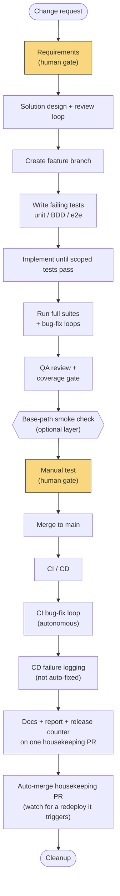

# Workflow Overview

What Waypoint is, why it exists, and how a change actually moves through it from idea to
deployed, documented, reported-on reality.

## What Waypoint is

Waypoint is a **spec-first, test-first development pipeline** for [Claude Code](https://claude.com/claude-code),
built around one orchestrator skill — `/ship-feature` — that drives a team of specialized
subagents through every stage of shipping a change: turning a rough request into tested
requirements, designing and reviewing a solution, writing tests before any implementation exists,
implementing until they pass, running full quality gates, merging, watching CI/CD, updating docs,
and writing a report of what happened.

It was extracted from a real, working pipeline ([`throughline`](https://github.com/lauz9888/throughline),
a small PWA project that was developed using this workflow) into a reusable template, so any
project can adopt the same discipline without re-inventing it. If you're
looking to *adopt* Waypoint rather than understand how it works internally, see the
[User Guide](User-Guide) instead — this page is about the mechanics.

## Why it exists

Most AI-assisted coding falls into one of two failure modes: either every change is a fresh,
unstructured conversation with no consistent quality bar, or a rigid script that can't adapt to
what a codebase actually looks like. Waypoint tries to avoid both by committing to a small number
of hard rules and then trusting agents to use judgment inside them. Those hard rules are the
**guarantees** below — they hold for every generated pipeline, regardless of stack or optional
layers. Everything after that section is **implementation detail**: the mechanics of how those
guarantees get delivered in this version of Waypoint, and free to change without breaking the
guarantees themselves.

## Guarantees

These are the commitments that hold in any pipeline `waypoint-init` generates, independent of how
the mechanics below happen to work today:

- **Every decision is grounded in the actual codebase**, never in assumptions — a requirements
  analyst reads the code before writing requirements; a solution designer reads existing patterns
  before proposing new ones; `waypoint-init` itself inspects a project's `package.json` before
  asking a single question.
- **Tests are written first, and proven to fail for the right reason**, before any implementation
  exists — a red test that fails because of a typo isn't a red test, it's a broken one.
- **Humans gate exactly two decisions**: what to build (requirements approval) and whether it works
  (manual testing). Everything in between — design review, coverage gates, bug-fixing, CI — runs
  autonomously, because it's checkable by machine.
- **Subagents never talk to the user.** Only the orchestrator does. Every subagent reads files, does
  work, and hands back a single `STATUS:` line the orchestrator acts on. This keeps the user-facing
  conversation coherent instead of splintering across a dozen agents.
- **Accessibility is baseline, not opt-in.** Every UI-facing requirement gets testable WCAG 2.1 AA
  criteria and an automated scan, by default, the same way a functional requirement gets a test.
- **Nothing loops forever.** Every retry cycle (design review, red/green cycles, QA, manual test,
  CI) is capped at 5 iterations; hitting the cap stops and asks the user how to proceed instead of
  spinning.

## Implementation details

The rest of this page is about *how* those guarantees are currently delivered — stage numbering,
agent names, file layout. None of it is a promise the way the guarantees above are; it's the
current shape of the machinery, and it's expected to evolve.

### The pipeline, stage by stage

The full pipeline (every optional layer enabled) is 22 steps, plus one out-of-band step (21a)
that fires only every so often — see [Periodic quality reporting](#periodic-quality-reporting)
below. The 22 steps fall into eight phases:

| Phase | Steps | What happens |
|---|---|---|
| **1. Requirements** | 1–2 | The user's request becomes a precise, testable `requirements.md` — the first human gate. |
| **2. Design** | 3 | A solution design is proposed and reviewed against the requirements until it holds up — no human gate; the reviewer is the check. |
| **3. Branch** | 4 | A feature branch is created. |
| **4. Test-first (red)** | 5–7 | Unit, BDD, and e2e tests are written for behavior that doesn't exist yet, and each is confirmed to fail *for the right reason*. |
| **5. Implementation (green)** | 8 | The implementer builds to the approved design and requirements — the red tests are immediate, executable evidence it got there, not the complete definition of done — while staying scoped to what the design describes. |
| **6. Full suites + bug loops** | 9–11 | Each full test suite runs; any failure is filed as a GitHub issue and fixed in a loop until green. |
| **7. Quality gates** | 12–14 | QA review + combined coverage gate, an optional pre-merge base-path smoke check, then manual testing — the second human gate. |
| **8. Ship** | 15–22 | Merge, CI/CD (watched, with an autonomous CI bug-fix loop; CD failures are logged, not auto-fixed, and the release is recorded as merged-but-not-live rather than shipped), then docs reconciliation, the post-change report, and the release counter/metrics land together as one reviewed housekeeping PR (not direct pushes to `main`) before cleanup. |

#### The flow

The two gold boxes are the only points a human has to act. Everything else — including every loop
in the diagram that isn't drawn as a loop — runs autonomously, retrying up to 5 times before it
stops and asks for help.

### The agent roster

The orchestrator (`/ship-feature` itself, running in your main conversation) never writes code or
tests directly — it spawns these subagents and acts on their `STATUS:` reports:

| Agent | Role |
|---|---|
| `requirements-analyst` | Turns a raw request into a numbered, testable `requirements.md`, grounded in the existing codebase. Asks clarifying questions rather than guessing. |
| `solution-designer` | Proposes file-level changes to satisfy the requirements — coverage map, test impact, accessibility decisions, ADRs where warranted. |
| `solution-reviewer` | Judges the design against the requirements and codebase — coverage, fit, scope, testability, accessibility — and hands back approve or specific feedback. |
| `unit-test-author` | Writes unit tests for behavior that doesn't exist yet and proves they're red for the right reason. |
| `bdd-test-author` *(optional layer)* | Same, for a Gherkin/behavioral test layer, if the project has one. |
| `e2e-test-author` | Same, for full end-to-end specs. |
| `implementer` | Turns the approved design into working code, scoped to making the red tests green — no unrequested refactors. |
| `bug-fixer` | Given one concrete failure and one reproduce command, fixes the root cause. Invoked repeatedly by every bug-fix loop in the pipeline. |
| `qa-reviewer` | The last check before merge: code quality, testability, security hygiene, accessibility, and the combined coverage gate. Makes small fixes directly; escalates the rest. |
| `docs-updater` | Reconciles README and the wiki against what actually merged and deployed — checked against current state, not just the diff. |
| `report-generator` | Compiles the post-change report: requirements, solution, test changes, bugs raised/resolved, total time (including human wait time). |
| `quality-reporter` | Compiles rollup weekly (past 8 weeks) and monthly (since Waypoint's adoption) reports across every completed run: release velocity, defect density, shift-left analysis, requirement delivery time, coverage trend, and bug-fix churn. Runs automatically every so often, or on demand. |

### Optional layers

Not every project needs every layer. Two are toggled per adopting project (see the
[User Guide](User-Guide) for how):

- **BDD** — a separate Gherkin/behavioral test layer between unit and e2e. Some teams want it;
  many run unit + e2e only.
- **Static, path-prefixed deploy** — the pre-merge base-path smoke check and PWA-style
  manifest/service-worker handling, relevant only to a client-only build served under a non-root
  path (e.g. GitHub Pages under `/reponame/`). Doesn't apply to a server-rendered app, an API, or a
  root-path deploy.

Turning a layer off removes its steps and agent(s) entirely from the generated pipeline rather
than leaving inert scaffolding behind.

### What's fixed, not configurable

Two things are deliberately **not** templated, in this version:

- **GitHub** as the VCS and issue tracker — every `gh` CLI call is literal. Supporting another host
  is real work with no proven demand yet.
- **The npm-style script-name contract** (`build`, `typecheck`, `lint`, `test:unit`, `test:e2e`,
  `test:coverage:merge`, etc.) — every adopting project commits to these script *names*, whatever
  tool actually implements each one.

Accessibility scanning is *not* optional either, but for the opposite reason: Waypoint's whole
premise is a workflow for web app development, so WCAG conformance is treated as baseline, like a
functional requirement, not a layer a project can decline.

### How a run stays resumable

Every `/ship-feature` run keeps its state in `.workflow/<slug>/` — gitignored, local scratch, never
part of the PR:

- `requirements.md`, `design.md` — the working documents.
- `state.md` — current step, branch name, tracking issue number, per-layer test file lists, open
  bug issue numbers. Updated after every step.
- `meta.json` — when the run started, for the final report's duration metric.

If you close Claude Code mid-run and come back, invoking `/ship-feature` again with no new request
finds the incomplete run and picks up exactly where it left off.

### Periodic quality reporting

Every completed run's `report-generator` step writes a small machine-readable metrics block into
its report (tracking issue, elapsed time, combined coverage %, and a count of bugs raised at each
pipeline stage) alongside the human-readable summary — that block is the raw data source for
everything below. A separate agent, `quality-reporter`, reads every one of those blocks across
`reports/*.md` (which *is* the project's release log — one file per completed, deployed change)
and rolls them up into two documents written to `reports/metrics/`.

#### What you get

Two markdown reports, each with a written summary up top and a table with one row per time
bucket:

- **`reports/metrics/weekly-<date>.md`** — the 8 most recent calendar weeks, most recent first.
- **`reports/metrics/monthly-<date>.md`** — every calendar month since the earliest report on
  file, i.e. since Waypoint was adopted in this project.

Both cover the same six metrics, computed per bucket:

| Metric | What it tells you |
|---|---|
| **Release velocity** | How many changes shipped to live in that period — is throughput rising, falling, or flat? |
| **Defect density** | Bugs raised per release in that period — is each release getting cleaner or messier over time? |
| **Shift-left histogram** | Which pipeline stage caught each defect, in order from `requirement` through `cd` — with an explicit **post-merge delivery-failure rate**, the share labeled `cd`. This is the headline number: it answers "are we catching problems earlier or later?" It's also why CD failures get their own `cd` label distinct from pre-merge `ci` failures — Step 18 catches things before merge, Step 19 only catches things after the change already merged. Note what `cd` does *not* claim: it means the CD workflow itself failed after merge (build/package/auth/upload/deploy), not that a confirmed defect reached a live user — a `cd` failure often means the previous version stayed live and nothing new shipped. `security`/`accessibility` labels are a separate, informational classification layered on top of a stage label, never counted as their own row here — an issue is counted once, under its stage. |
| **Average requirement delivery time** | Mean hours from requirements kickoff to CD-live, across that period's releases. |
| **Coverage trend** | Mean combined test coverage % across that period's releases. |
| **Bug-fix churn** | Mean bugs raised per release — the same numerator as defect density, but tracked as its own row so a churn spike is visible even in a period where release count also moved. |

Each report also closes with a plain-language comparison of the most recent bucket against the
oldest one in that report (velocity, post-merge delivery-failure rate, delivery time — up, down,
or flat), so you don't have to eyeball 8 rows of numbers to get the headline. Every release also
carries an outcome, `deployed` or `merged-deployment-failed` (the change merged but Step 19's CD
watch failed, so it never actually went live) — velocity and delivery-time only count `deployed`
releases, while defect density, the shift-left histogram, and coverage trend count every merged
release regardless of outcome, since a defect or a coverage number doesn't stop being real just
because the deploy itself failed. If fewer than two releases exist yet, both reports say so
plainly instead of drawing a trend line through one data point.

#### When it's triggered automatically

Every successful release counts: each time a change merges and its CD deploy to `main`/live
succeeds (Step 19), a small committed counter — `reports/.release-count` — is incremented by 1
(Step 21a). The moment that counter is an exact multiple of the configured cadence — **10 by
default**, e.g. every 10th release — `quality-reporter` runs automatically, right there in the
same pipeline run that tripped the milestone, and the two new report paths (plus a one-line
headline summary) are folded into that run's final summary to you. No separate action needed.

The cadence lives in `.claude/STANDARDS.md`'s "Release report cadence" section — edit the
`{{RELEASE_REPORT_CADENCE}}` value there if you want reports more or less often (e.g. `5` for a
fast-moving project, `20` for a slower one).

#### How to trigger it manually

Run `/quality-report` — no arguments needed. It spawns `quality-reporter` against whatever release
history already exists, writes both reports, commits them, and tells you the
two file paths plus a one-line headline summary (velocity trend, post-merge delivery-failure rate).
There's no loop or retry cap here — it's a deterministic read over existing data, so a stale or
unwanted run just gets superseded the next time this runs, automatically or by hand. Use it any
time you want a current read without waiting for the cadence to land on a milestone: before a
retro, a stakeholder update, or just out of curiosity.

### Templates vs. your project's actual pipeline

This repository (Waypoint) holds **templates** — files with placeholders like `{{PROJECT_NAME}}`
and conditional blocks for the optional layers — not a runnable pipeline itself. `waypoint-init`
reads those templates, inspects *your* project, and writes out a concrete, literal pipeline into
*your* `.claude/` directory: real framework names, real thresholds, no template syntax left behind.
From then on, your project's copy is yours — edit it freely, it has no ongoing link back to this
repository. See the [User Guide](User-Guide) to actually do this.

## A hypothetical example

To make the stages concrete, here's how a small, ordinary change might move through the pipeline
for a fictional project — a React/Node todo-list app called `taskly`, with the BDD layer off and
the path-prefixed deploy layer off (a normal server-hosted app, not a GitHub Pages build).

**The request:** the user types `/ship-feature let users mark a task as high priority, with a
visual indicator in the list`.

1. **Requirements.** `requirements-analyst` reads `taskly`'s existing task model and list component,
   then drafts `requirements.md`: a `priority` field on the task model (default `normal`, allowed
   values `normal`/`high`), a toggle in the task's edit UI, a visual indicator (icon + color, not
   color alone, to satisfy accessibility) in the list view, and a testable WCAG criterion for the
   indicator's contrast and screen-reader label. It asks the user one clarifying question — "should
   high-priority tasks sort to the top, or keep their existing order?" — and the user answers
   "keep existing order, that's a separate feature." **The user reviews and approves the
   requirements** — the first human gate.
2. **Design.** `solution-designer` proposes the file-level changes: a migration for the new
   `priority` column, a change to the task API's create/update handlers, a new `PriorityBadge`
   component, and a coverage map showing which requirement each test will cover. `solution-reviewer`
   checks it against the requirements, flags that the design doesn't say what happens to *existing*
   tasks after the migration runs, and sends it back. The designer adds an explicit default-backfill
   note; the reviewer approves on the second pass. No human is asked to weigh in on this loop.
3. **Branch.** `feature/high-priority-tasks` is created off `main`.
4. **Tests, written red.** `unit-test-author` writes tests for the model default, the API validation
   (rejecting an invalid priority value), and the badge component's rendering and ARIA label;
   `e2e-test-author` writes a test that marks a task high-priority through the UI and asserts the
   badge appears. Both are run and confirmed to fail — not because of a typo, but because the
   feature genuinely doesn't exist yet.
5. **Implementation.** `implementer` writes exactly enough code to turn those tests green: the
   migration, the API change, the badge component, the toggle. No unrelated refactor of the task
   list, even though the implementer notices the list component could be tidied up — that's out of
   scope for this change.
6. **Full suites + bug loops.** The full unit and e2e suites run. One unrelated flaky test in the
   existing suite fails; `bug-fixer` is handed that single failure and its reproduce command, fixes
   the root cause (a timing issue, unrelated to priority), and the suite goes green.
7. **Quality gates.** `qa-reviewer` checks the diff for code quality and security hygiene, confirms
   the accessibility criterion from step 1 has an automated scan behind it, and checks combined
   coverage against `taskly`'s threshold. Coverage is a point short on the migration's rollback
   path; `qa-reviewer` adds the missing test itself rather than escalating.
8. **Manual testing.** The app starts locally and the user is given a URL. They mark a task
   high-priority, see the badge, and confirm it looks right — the second and last human gate.
9. **Ship.** The branch merges via PR, CI/CD run and pass — the release is recorded as `deployed`
   in `state.md`. `docs-updater` checks whether `taskly`'s README mentions the task model and
   updates it, and `report-generator` writes `reports/2026-07-25-high-priority-tasks.md`
   summarizing the requirement, the design, every test file touched, the one flaky-test bug raised
   and fixed along the way, and the total time — including the time spent waiting on the two human
   gates. Both land together on one `docs/high-priority-tasks` housekeeping PR, which auto-merges
   since `taskly`'s repo has no required-review rule on it; no redeploy is triggered, since
   `taskly`'s CD workflow excludes `reports/**` from its trigger paths.

Nothing about *this* example is special — it's deliberately mundane, because the guarantees above
are meant to hold just as well for a one-field change as for something architecturally bigger.
