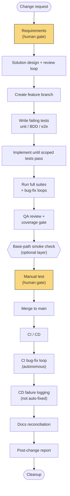

# Workflow Overview

What Waypoint is, why it exists, and how a change actually moves through it from idea to
deployed, documented, reported-on reality.

## What Waypoint is

Waypoint is a **spec-first, test-first development pipeline** for [Claude Code](https://claude.com/claude-code),
built around one orchestrator skill — `/ship-feature` — that drives a team of specialized
subagents through every stage of shipping a change: turning a rough request into tested
requirements, designing and reviewing a solution, writing tests before any implementation exists,
implementing until they pass, running full quality gates, merging, watching CI/CD, updating docs,
and writing a report of what happened.

It was extracted from a real, working pipeline (`throughline`, a small PWA project) into a
reusable template, so any project can adopt the same discipline without re-inventing it. If you're
looking to *adopt* Waypoint rather than understand how it works internally, see the
[User Guide](User-Guide) instead — this page is about the mechanics.

## Why it exists

Most AI-assisted coding falls into one of two failure modes: either every change is a fresh,
unstructured conversation with no consistent quality bar, or a rigid script that can't adapt to
what a codebase actually looks like. Waypoint tries to avoid both by committing to a small number
of hard rules and then trusting agents to use judgment inside them:

- **Ground every decision in the actual codebase**, never in assumptions — a requirements analyst
  reads the code before writing requirements; a solution designer reads existing patterns before
  proposing new ones; `waypoint-init` itself inspects a project's `package.json` before asking a
  single question.
- **Tests are written first, and proven to fail for the right reason**, before any implementation
  exists — a red test that fails because of a typo isn't a red test, it's a broken one.
- **Humans gate the two decisions that actually need a human**: what to build (requirements
  approval) and whether it works (manual testing). Everything in between — design review, coverage
  gates, bug-fixing, CI — runs autonomously, because it's checkable by machine.
- **Subagents never talk to the user.** Only the orchestrator does. Every subagent reads files, does
  work, and hands back a single `STATUS:` line the orchestrator acts on. This keeps the user-facing
  conversation coherent instead of splintering across a dozen agents.
- **Accessibility is baseline, not opt-in.** Every UI-facing requirement gets testable WCAG 2.1 AA
  criteria and an automated scan, by default, the same way a functional requirement gets a test.
- **Nothing loops forever.** Every retry cycle (design review, red/green cycles, QA, manual test,
  CI) is capped at 5 iterations; hitting the cap stops and asks the user how to proceed instead of
  spinning.

## The pipeline, stage by stage

The full pipeline (every optional layer enabled) is 22 steps. They fall into eight phases:

| Phase | Steps | What happens |
|---|---|---|
| **1. Requirements** | 1–2 | The user's request becomes a precise, testable `requirements.md` — the first human gate. |
| **2. Design** | 3 | A solution design is proposed and reviewed against the requirements until it holds up — no human gate; the reviewer is the check. |
| **3. Branch** | 4 | A feature branch is created. |
| **4. Test-first (red)** | 5–7 | Unit, BDD, and e2e tests are written for behavior that doesn't exist yet, and each is confirmed to fail *for the right reason*. |
| **5. Implementation (green)** | 8 | The implementer makes exactly those tests pass — no more, no less. |
| **6. Full suites + bug loops** | 9–11 | Each full test suite runs; any failure is filed as a GitHub issue and fixed in a loop until green. |
| **7. Quality gates** | 12–14 | QA review + combined coverage gate, an optional pre-merge base-path smoke check, then manual testing — the second human gate. |
| **8. Ship** | 15–22 | Merge, CI/CD (watched, with an autonomous CI bug-fix loop; CD failures are logged, not auto-fixed), docs reconciliation, a post-change report, and cleanup. |

### The flow

The two gold boxes are the only points a human has to act. Everything else — including every loop
in the diagram that isn't drawn as a loop — runs autonomously, retrying up to 5 times before it
stops and asks for help.

## The agent roster

The orchestrator (`/ship-feature` itself, running in your main conversation) never writes code or
tests directly — it spawns these subagents and acts on their `STATUS:` reports:

| Agent | Role |
|---|---|
| `requirements-analyst` | Turns a raw request into a numbered, testable `requirements.md`, grounded in the existing codebase. Asks clarifying questions rather than guessing. |
| `solution-designer` | Proposes file-level changes to satisfy the requirements — coverage map, test impact, accessibility decisions, ADRs where warranted. |
| `solution-reviewer` | Judges the design against the requirements and codebase — coverage, fit, scope, testability, accessibility — and hands back approve or specific feedback. |
| `unit-test-author` | Writes unit tests for behavior that doesn't exist yet and proves they're red for the right reason. |
| `bdd-test-author` *(optional layer)* | Same, for a Gherkin/behavioral test layer, if the project has one. |
| `e2e-test-author` | Same, for full end-to-end specs. |
| `implementer` | Turns the approved design into working code, scoped to making the red tests green — no unrequested refactors. |
| `bug-fixer` | Given one concrete failure and one reproduce command, fixes the root cause. Invoked repeatedly by every bug-fix loop in the pipeline. |
| `qa-reviewer` | The last check before merge: code quality, testability, security hygiene, accessibility, and the combined coverage gate. Makes small fixes directly; escalates the rest. |
| `docs-updater` | Reconciles README and the wiki against what actually merged and deployed — checked against current state, not just the diff. |
| `report-generator` | Compiles the post-change report: requirements, solution, test changes, bugs raised/resolved, total time (including human wait time). |

## Optional layers

Not every project needs every layer. Two are toggled per adopting project (see the
[User Guide](User-Guide) for how):

- **BDD** — a separate Gherkin/behavioral test layer between unit and e2e. Some teams want it;
  many run unit + e2e only.
- **Static, path-prefixed deploy** — the pre-merge base-path smoke check and PWA-style
  manifest/service-worker handling, relevant only to a client-only build served under a non-root
  path (e.g. GitHub Pages under `/reponame/`). Doesn't apply to a server-rendered app, an API, or a
  root-path deploy.

Turning a layer off removes its steps and agent(s) entirely from the generated pipeline rather
than leaving inert scaffolding behind.

## What's fixed, not configurable

Two things are deliberately **not** templated, in this version:

- **GitHub** as the VCS and issue tracker — every `gh` CLI call is literal. Supporting another host
  is real work with no proven demand yet.
- **The npm-style script-name contract** (`build`, `typecheck`, `lint`, `test:unit`, `test:e2e`,
  `test:coverage:merge`, etc.) — every adopting project commits to these script *names*, whatever
  tool actually implements each one.

Accessibility scanning is *not* optional either, but for the opposite reason: Waypoint's whole
premise is a workflow for web app development, so WCAG conformance is treated as baseline, like a
functional requirement, not a layer a project can decline.

## How a run stays resumable

Every `/ship-feature` run keeps its state in `.workflow/<slug>/` — gitignored, local scratch, never
part of the PR:

- `requirements.md`, `design.md` — the working documents.
- `state.md` — current step, branch name, tracking issue number, per-layer test file lists, open
  bug issue numbers. Updated after every step.
- `meta.json` — when the run started, for the final report's duration metric.

If you close Claude Code mid-run and come back, invoking `/ship-feature` again with no new request
finds the incomplete run and picks up exactly where it left off.

## Templates vs. your project's actual pipeline

This repository (Waypoint) holds **templates** — files with placeholders like `{{PROJECT_NAME}}`
and conditional blocks for the optional layers — not a runnable pipeline itself. `waypoint-init`
reads those templates, inspects *your* project, and writes out a concrete, literal pipeline into
*your* `.claude/` directory: real framework names, real thresholds, no template syntax left behind.
From then on, your project's copy is yours — edit it freely, it has no ongoing link back to this
repository. See the [User Guide](User-Guide) to actually do this.
